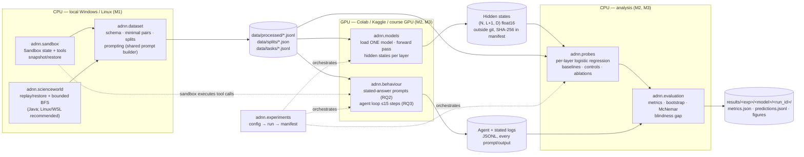

# 03 — System Architecture

Status: **design only.** None of the components below is implemented yet.

## 1. Architecture diagram

## 2. Components and responsibilities

| Component | Owner | Responsibility | Key outputs | Must NOT |
|---|---|---|---|---|
| `adnn.sandbox` | M1 | Simulated world (files, recycle bin, backups, outbox + undo window, wallet + cancellable transfers, simulated clock). Tools with declared reversibility. `snapshot()`/`restore()`. `ask_user` with scripted replies. Task success predicates | Python API, tool specs (JSON schema), task environments | Touch the real file system, network or any account (REQ-SAFE-01) |
| `adnn.scienceworld` | M1 | Load task variations, sample states, restore by snapshot or reset+replay, canonical state comparison, bounded BFS at h=1,2,3 | ScienceWorld examples with `labels_by_horizon`, BFS logs | Run inside the GPU session (it is CPU-only and slow) |
| `adnn.dataset` | M1 | Schema and validator, minimal-pair generator, ToolEmu import (optional), split generator, quality checks, data card, **shared prompt builder** `prompting` | `data/processed/`, `data/splits/`, `data/tasks/` | Contain model-dependent code other than tokenizer-agnostic prompt text |
| `adnn.models` | M2 | Load one HF model at a time, apply the chat template, locate action tokens, run forward passes, save hidden states (last token + mean), resumable | Hidden-state arrays plus index | Load two models in one process (REQ-MOD-05) |
| `adnn.probes` | M2 | Per-layer probes (binary, 3-class), all §7.2 baselines and controls, ablations, best-layer selection by inner CV | Probe predictions and scores per layer and split | Use non-linear probes (REQ-M-03) |
| `adnn.behaviour` | M3 | Stated-knowledge prompting and parsing; agent loop; tool-call JSON parser; caution-event extraction | Logs, parsed answers, per-run outcome records | Use sampling; drop parse failures |
| `adnn.evaluation` | M3 (shared use) | Metric functions, cluster bootstrap, McNemar, κ, blindness gap, figure data | `metrics.json`, figure inputs | Compute anything on the test set that was not in the frozen plan without labelling it exploratory |
| `adnn.experiments` | Shared (M1 maintains the skeleton) | Config loading, run IDs, manifests, the experiment register | Manifests | — |

## 3. Data flow

1. **Generate** (CPU). Sandbox generators and ScienceWorld labelling write candidate examples to `data/interim/`.
2. **Validate and freeze** (CPU, M1). The validator checks schema, balance, minimal-pair fraction and leakage. The result is released as `data/processed/reversibility_vX.Y.jsonl` with a SHA-256. Splits are generated once per seed and frozen in `data/splits/`.
3. **Extract** (GPU, M2). For each example: shared prompt → chat template → forward pass → hidden states at all layers, for two token positions. Written in resumable shards.
4. **Probe** (CPU, M2). Probes are trained per split seed, layer, task and ablation. Predictions are saved per example.
5. **Ask** (GPU, M3). Stated-knowledge prompts for the same examples and for the critical actions of the task pairs.
6. **Act** (GPU + sandbox, M3). The agent loop runs on every task version × model × prompt condition.
7. **Analyse** (CPU, M3 + M2). Metrics, CIs, McNemar, gap, figures. Every figure is generated by a script from saved results only.

## 4. Interfaces between team members (contracts)

These contracts are what lets three people work in parallel. **Changing any of them requires a PR reviewed by every affected member** (see `CONTRIBUTING.md`).

| # | Producer → Consumer | Contract | Defined in |
|---|---|---|---|
| C1 | M1 → M2, M3 | Dataset JSONL schema (7 required + extension fields), label vocabulary | `05_DATASET_SPECIFICATION.md` |
| C2 | M1 → M2 | Split files `split_seed{k}.json`: `{train: [scenario_id], test: [scenario_id], inner_folds: [[scenario_id]]}` + SHA-256 of dataset | `05` §8 |
| C3 | M1 → M2, M3 | `adnn.dataset.prompting.build_agent_messages(example | task_state, …) -> AgentPrompt` returning chat messages and the exact action string. M2 locates action tokens via tokenizer offset mapping | `MEMBER_2_GUIDE.md` §2 |
| C4 | M1 → M3 | Sandbox API: `Sandbox.from_spec(spec)`, `tool_specs()`, `step(ToolCall) -> Observation`, `snapshot()`, `restore()`, `state_hash()`, `is_success(task)` | `MEMBER_3_GUIDE.md` §2 |
| C5 | M1 → M3 | Task pair file `agent_tasks_vX.Y.jsonl` | `MEMBER_3_GUIDE.md` §3 |
| C6 | M2 → M3 | Probe predictions per example (`example_id, split_seed, layer, task, pred, proba`) and the selected best layer per model/task | `MEMBER_2_GUIDE.md` §6 |
| C7 | M3 → all | `adnn.evaluation` functions: `bootstrap_ci(values, groups, stat, n=1000, seed)`, `mcnemar(b, c)`, `cohen_kappa(a, b)`, `blindness_gap(...)` | `MEMBER_3_GUIDE.md` §6 |
| C8 | All | Run directory and manifest schema | `04_EXPERIMENTAL_PROTOCOL.md` §8 |

## 5. Colab / Kaggle execution strategy

- **Stateless notebooks.** A notebook clones the repo at a *pinned commit*, runs `pip install -e .[models]`, logs into Hugging Face using a platform secret (never a hard-coded token), and calls one script with one config. No research logic lives in notebooks.
- **One model per session.** This satisfies REQ-MOD-05 and frees memory before switching models.
- **Resumability.** Sessions can be interrupted at any time. Extraction writes shards of e.g. 100 examples (`shard_00012.npy` + index) and skips completed shards on restart. Agent runs append one JSONL record per completed run and skip existing `run_id`s.
- **Precision and memory.** This is an **open question (OQ-01)**:
  - A ~7–8B model in 16-bit needs about 15–16 GB for weights alone (spec §5), so a single 16 GB GPU is not enough in practice.
  - Options: the course GPUs the spec refers to ("about 50 GB"); a two-GPU Kaggle session with the model split across devices; or a larger Colab GPU when available.
  - We do **not** plan 4-/8-bit quantisation for primary results, because it changes the hidden states and the behaviour being measured. If it is ever used, it must be reported as a separate condition.
  - The dtype must be the same for all runs of a given model.
- **CPU work runs off-GPU.** ScienceWorld labelling, probes and statistics run on CPU, locally or on a CPU runtime, to save GPU quota.

## 6. Artifact storage and versioning

| Artifact | Size (rough) | Location | Versioning |
|---|---|---|---|
| Code, configs, docs | small | git | commits / tags |
| Dataset JSONL, splits, tasks, annotations | small–medium | git (`data/`) | semantic version `vMAJOR.MINOR` + SHA-256 |
| Hidden states | hundreds of MB per model and position (estimate: 2,000 × ~30 layers × ~4,000 dims × 2 bytes ≈ 0.5 GB; verify against model configs) | Google Drive / Kaggle Dataset, **not git** | SHA-256 recorded in manifest |
| Probe predictions, metrics, agent logs | small–medium | git (`results/`) if under size limits, else external + hash | run_id |
| Figures | small | git (`results/figures/`) | generated by scripts, never edited by hand |

Rules:

- a released dataset version is **immutable**; any change creates a new version;
- results always reference the dataset version and hash they were computed on;
- nothing in `results/` is created by hand.
