# 09 — Project Roadmap

The course deadline is not yet recorded here (OQ-18), so phases use **relative weeks** (W1 = the week of 2026-10-30). They should be mapped to calendar dates once the deadline is known. The spec asks for the minimum publishable result "well before the submission deadline", with bonus work only after it (REQ-MPR-01).

## Phase overview

```mermaid
gantt
    dateFormat  X
    axisFormat  W%s
    section Setup
    P1 Setup, literature, access          :p1, 1, 2
    section Data (M1)
    P2 Sandbox + sandbox data + prompts   :p2, 2, 4
    P3 ScienceWorld + agreement + freeze  :p3, 3, 6
    section Measurement (M2, M3)
    P4 Extraction + probes (RQ1)          :p4, 4, 8
    P5 Stated + behaviour (RQ2, RQ3)      :p5, 4, 8
    section Integration
    P6 Llama, ablations, stats, MPR       :p6, 7, 10
    P7 Report, release, presentation      :p7, 9, 12
```

(The bar positions are a proposal, not a commitment.)

## Phase 1 — Setup, literature, access (W1–W2)

**Goal:** a repository and plan everyone agrees on; access and compute secured; novelty checked.

**Milestones:**

- M1.1 repository scaffold and documentation (this commit);
- M1.2 Llama access applied for by every member;
- M1.3 Group A read by all; Group B assigned;
- M1.4 first novelty search logged;
- M1.5 OQ-01 (compute) and the blocking questions in `OPEN_QUESTIONS.md` answered by the professor or the team.

**Dependencies:** none.

**Definition of done:**

- the team has reviewed all docs;
- every blocking open question has an answer or a decision record;
- Python 3.11 venv installs and `pytest` passes the scaffold test on at least one machine.

## Phase 2 — Sandbox, sandbox data, prompt builder (W2–W4)

**Goal:** a working sandbox with verified reversibility; a pilot dataset that unblocks M2/M3.

**Milestones:**

- M2.1 sandbox state + tools + snapshot/restore + tests;
- M2.2 brute-force verifier agrees with every declared label;
- M2.3 shared prompt builder (C3) reviewed by M2 and M3;
- M2.4 pilot dataset D3 (~200 sandbox examples, minimal pairs included);
- M2.5 first 10 task pairs (with M3).

**Dependencies:** P1; sandbox tool list agreed with M3.

**Definition of done:**

- all sandbox tests pass, including the safety test;
- M2 has extracted hidden states for 10 pilot examples;
- M3 has run the agent loop on 2 tasks.

## Phase 3 — ScienceWorld, human agreement, dataset freeze (W3–W6)

**Goal:** frozen dataset v1.0 (≥2,000 examples, ≥30% minimal pairs), frozen splits, ≥60 task pairs.

**Milestones:**

- M3.1 ScienceWorld API checked; restore mechanism working;
- M3.2 BFS labeller with h=1,2,3 + audit;
- M3.3 full sandbox generation;
- M3.4 validator passes;
- M3.5 100-example agreement study with κ;
- M3.6 dataset v1.0 + splits (3 seeds) + task pairs v1.0 frozen; data card draft.

**Dependencies:** P2; OQ-03 (partial label in ScienceWorld) and OQ-04 decided.

**Definition of done:** all `05` §9 checks pass; hashes recorded; tagged release `data-v1.0`.

## Phase 4 — Hidden-state extraction and probes, RQ1 (W4–W8; M2)

**Milestones:**

- M4.1 extraction pipeline on pilot data;
- M4.2 Qwen extraction on v1.0;
- M4.3 all probes + controls on Qwen with 3 splits;
- M4.4 ablations A1–A4 on Qwen;
- M4.5 F1 draft.

**Dependencies:** D2, D4, compute (OQ-01). The analysis plan must be frozen before M4.3 touches test sets.

**Definition of done:** Qwen RQ1 results with CIs; sanity checks from `04` §3 passed and recorded.

## Phase 5 — Stated knowledge and behaviour, RQ2 and RQ3 (W4–W8; M3)

**Milestones:**

- M5.1 parser + agent loop on the sandbox;
- M5.2 caution rules with unit tests;
- M5.3 pilot base-rate check;
- M5.4 Qwen stated-knowledge run;
- M5.5 Qwen agent runs (neutral, plus careful if A5);
- M5.6 evaluation utilities (C7).

**Dependencies:** D1, D2, D5; D7 for κ (can be computed later).

**Definition of done:** Qwen RQ2 and RQ3 metrics and the gap with CIs; parse failures reported.

## Phase 6 — Second model, ablations, statistics, minimum publishable result (W7–W10)

**Milestones:**

- M6.1 Llama extraction + probes;
- M6.2 Llama stated + agent runs;
- M6.3 all figures/tables F1–F3, T1–T2;
- M6.4 experiment register complete;
- M6.5 **minimum publishable result check** (REQ-MPR-01).

**Definition of done:** every item of REQ-MPR-01 exists with CIs; the dataset is ready for release.

## Phase 7 — Report, release, presentation (W9–W12); bonus only after MPR

**Milestones:**

- M7.1 report draft (ACL/IEEE, 6–8 pages);
- M7.2 reproduction dry run on a clean checkout;
- M7.3 licence re-check + data card final;
- M7.4 presentation + recorded demo (one reversible, one irreversible task version);
- M7.5 contribution log.

**Optional (bonus):** RQ4 steering with ≥5 strengths and a random-direction control; RQ5 uncertainty.

**Definition of done:** all REQ-DEL-* items satisfied.

## Task checklist — Sneha (M1)

**Phase 1**

- [ ] Review all docs with M2/M3; fill in their names
- [ ] Send the blocking open questions to the professor (OQ-01, OQ-03, OQ-04, OQ-05)
- [ ] Apply for Llama 3.1 access; remind M2/M3 to apply
- [ ] Novelty search #1 logged in `references/README.md`
- [ ] Assign Group B papers
- [ ] Install Python 3.11, create the venv, run `pytest` and `ruff`; write the first lock file
- [ ] Check the ScienceWorld licence and current Python API (save/restore? state access?)

**Phase 2**

- [x] Sandbox state model + canonical state + `state_hash`
- [x] Tools with declared reversibility (table in `05` §3)
- [x] Simulated clock + undo window
- [ ] `ask_user` with scripted replies
- [x] Brute-force restore verifier (depth ≤ 3)
- [x] Safety test (forbidden imports/side effects)
- [ ] Prompt builder (C3) + review by M2/M3
- [ ] Sandbox example generator: templates, pivots, phrasing variants, distractors
- [ ] Pilot dataset D3 released to M2/M3
- [ ] First 10 task pairs with M3

**Phase 3**

- [ ] ScienceWorld restore + canonical state + BFS + pruning rule + audit
- [ ] Full dataset generation; validator green
- [ ] Annotation guidelines; 100-example study with annotator 2; κ
- [ ] Freeze dataset v1.0, splits (seeds 0/1/2), task pairs (≥60)
- [ ] Data card draft
- [ ] (Optional) ToolEmu cases

**Phases 6–7**

- [ ] Lock files for every platform used
- [ ] README reproduction table filled in and tested
- [ ] Licence re-verification (REQ-ENV-09); data card final
- [ ] Report: dataset/environment sections; integration of the full report

## Member 2 and Member 3 integration milestones

| # | When | M2 | M3 | Requires from M1 |
|---|---|---|---|---|
| I1 | End P2 | Extraction on 10 pilot examples; token-span check | Agent loop on 2 tasks; parser tests | D1, D2, D3 |
| I2 | P3 freeze | Full Qwen dry run, split seed 0, *train/inner-CV only* | Pilot base-rate check on 10 task pairs | D4, D5 |
| I3 | Plan freeze | Sign off `04` | Sign off `04` | — |
| I4 | End P4/P5 | Probe predictions + best layer (C6) delivered | Stated answers + agent outcomes delivered | — |
| I5 | P6 | Llama RQ1 | Llama RQ2/RQ3; gap; F2, F3 | — |
| I6 | MPR | All RQ1 figures/tables | All RQ2/RQ3 figures/tables | Data card |
